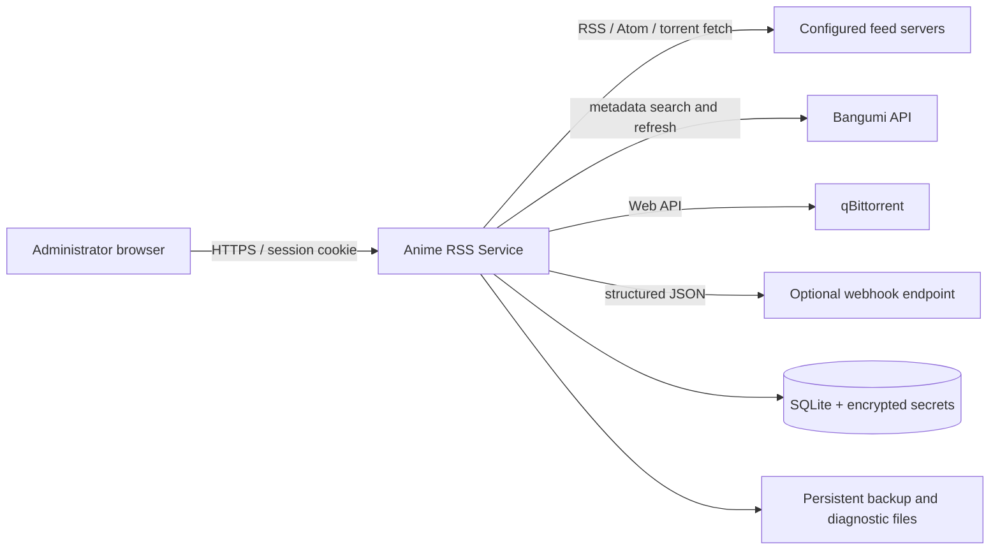
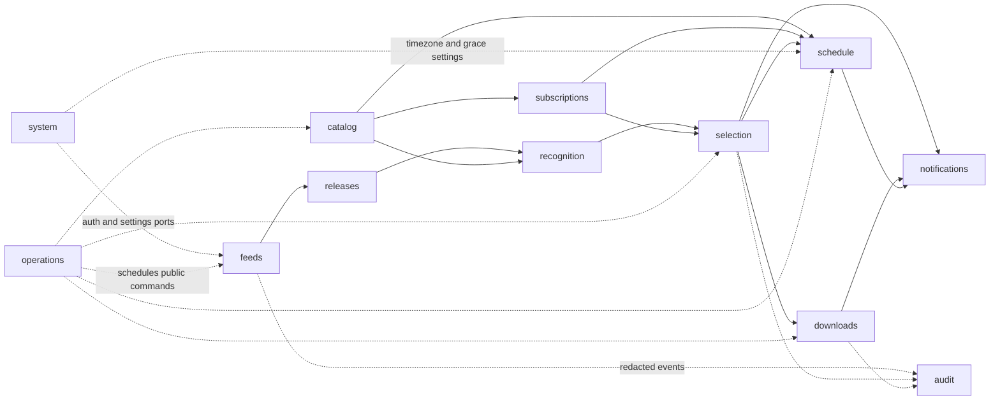
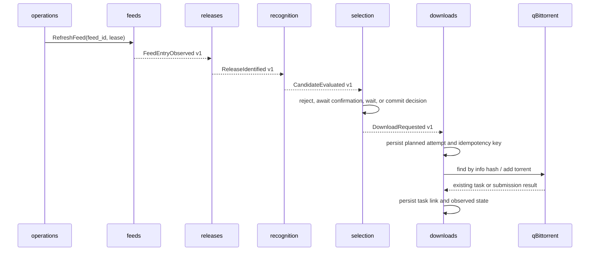
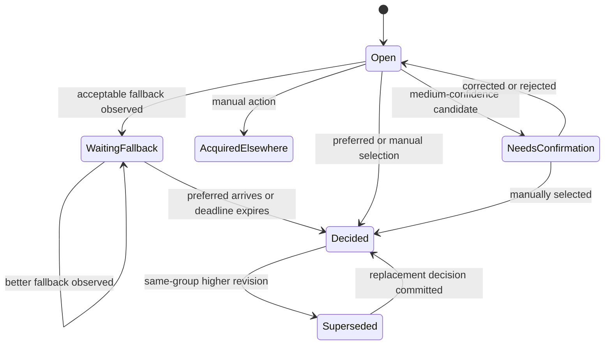

# Anime RSS Service Architecture

Status: Implemented modular-monolith baseline

Date: 2026-07-21

Source: `DESIGN.md`

## 1. Architecture Goals

The first release is a modular monolith: one deployable container, one backend
process group, one React application, and one SQLite database. Internally it is
split by product capability rather than by technical layer.

This shape is intentional. It keeps installation and operations appropriate for
a single-user NAS service while preserving boundaries that can later become
separate packages, workers, or services.

The architecture prioritizes, in order:

1. No duplicate or unexplained download submissions.
2. Durable decisions, waiting windows, retries, and downloader links.
3. Deterministic and independently testable parsing and selection.
4. Modules that can be understood without reading the whole repository.
5. Simple self-hosted operation with SQLite and Docker Compose.

The architecture is not a distributed system in advance. It adopts only the
boundaries and delivery semantics needed to make later extraction possible.

## 2. System Context



The service owns subscriptions, matching rationale, selection history, and the
link between a decision and a downloader task. qBittorrent owns the current
runtime state of that task. Neither Bangumi nor an airing schedule can directly
cause a download.

## 3. Runtime Topology

The production container contains:

- a FastAPI application serving `/api/v1`, health endpoints, and built React
  assets;
- a durable scheduler loop in the same process group;
- one SQLite database in WAL mode;
- a backup directory and bounded diagnostic storage in the persistent volume.

Use one Uvicorn worker by default. More HTTP workers do not improve this
single-user workload and would increase SQLite write contention. Correctness
must still tolerate a brief overlap of old and new processes during restart by
using database leases and compare-and-swap state transitions.

All network calls happen outside database write transactions. A worker first
claims work in a short transaction, performs the external call, and then records
the result in another short transaction. SQLite configuration must include a
busy timeout, foreign keys, and WAL where the mounted filesystem safely supports
it. Startup performs migrations before either HTTP traffic or scheduled work is
accepted.

## 4. Architectural Style

### 4.1 Package by capability

Each backend module contains its own domain model, use cases, persistence
adapter, HTTP router when applicable, and tests. There are no repository-wide
`models`, `services`, or `repositories` directories that require readers to jump
across the tree to understand one capability.

Each module exposes a small public surface through `api.py` and documents it in
its own `README.md`. Code outside the module must not import its ORM mappings,
repository implementation, or internal domain objects.

### 4.2 Ports and adapters inside each module

Business rules are plain Python and do not depend on FastAPI, SQLAlchemy,
qBittorrent, feedparser, or HTTP clients. Application use cases depend on ports;
adapters implement those ports.

Not every module needs four directory levels on day one. A small module may use
`domain.py`, `application.py`, and `adapters.py`; it should become subpackages
only after the files stop being readable as a unit.

### 4.3 Commands, queries, and events

- A **command** asks one module to change state and returns a small result DTO.
- A **query** reads a module-owned DTO and never exposes an ORM entity.
- A **domain event** is an internal fact used during the local transaction.
- An **integration event** is a persisted, versioned fact delivered to another
  module at least once.
- An **audit event** is the administrator-facing explanation of an action. It is
  not used as the message bus.

Direct Python calls are appropriate when the caller needs an immediate result.
Persisted integration events are appropriate for asynchronous workflows and
future extraction. Event handlers are idempotent.

## 5. Backend Modules

| Module | Owns | Public responsibilities | Must not own |
| --- | --- | --- | --- |
| `system` | administrator, sessions, installation state, timezone, secret references | setup progress, login/logout, session validation, settings, secret encryption | feed or downloader behavior |
| `feeds` | feed configuration, fetch state, feed entries, fetch attempts | safe fetching, RSS/Atom normalization, cache validators, retry health | torrent identity or title interpretation |
| `releases` | releases, source observations, torrent metadata and payload references | magnet normalization, torrent validation, info-hash identity, layered deduplication | anime matching or selection |
| `catalog` | anime, external IDs, titles, aliases, metadata and airing snapshots | Bangumi search/cache, local anime creation, user metadata and airing overrides | automatic download decisions |
| `recognition` | parsed-title results, match attempts, candidates, confidence, corrections | deterministic parsing, anime/episode matching, explanations | preferences or downloader tasks |
| `subscriptions` | subscriptions, rule profiles, activation cutoffs, lifecycle | effective rules and aliases linked to a subscription | candidate ranking or schedule state |
| `selection` | waiting state, decisions, manual overrides, rejections, upgrade plans | hard filters, lexicographic comparison, fallback timers, backfill preview, V2/V3 policy | external downloader calls |
| `schedule` | expected episodes, calendar state, missing-notification markers | weekly expectation projection, timezone calendar, episode history, missing-state evaluation | candidates, decisions, or download requests |
| `downloads` | qBittorrent configuration, submission attempts, idempotency keys, task links, observed state | default path/category/tags, submit/cancel/retry/reconcile | deciding which release should win |
| `notifications` | notification intents, delivery attempts, in-app notifications | policy for when to notify, JSON webhook delivery and retry | originating business decisions |
| `audit` | append-only administrator-facing events | searchable history and redacted diagnostic context | workflow coordination |
| `operations` | scheduled jobs, leases, backups, retention runs, health snapshots | durable scheduling, backup/restore, cleanup, readiness aggregation | product-domain state |

### 5.1 Important ownership rules

- `feeds` creates a feed entry even when no torrent identity is available.
  `releases` later resolves one or more observations to a unique release.
- `recognition` owns the evidence that a release represents an anime and
  episode. `selection` consumes that evidence but never reparses a title.
- `subscriptions` owns rule configuration; `selection` stores an immutable
  snapshot of the effective rules used by every consequential decision.
- `selection` commits a download request before `downloads` contacts
  qBittorrent. The downloader result cannot rewrite the reason for selection.
- `downloads` mirrors external task state. An external deletion updates task
  state but cannot reopen or erase the original decision.
- `audit` receives redacted facts from every module. Business modules never
  query audit rows to make decisions.
- `schedule` may derive a missing-episode warning from catalog, subscription,
  and selection public facts, but that warning only feeds UI and notification
  projections; it cannot enter the selection state machine as a synthetic
  candidate or emit a download request.

## 6. Dependency Direction



Arrows represent use of a public contract, not access to another module's
tables. Cycles are forbidden. In particular, downloader state never becomes an
input to title matching, and notification delivery never controls a business
transition.

Shared code is limited to a small `kernel` package containing stable technical
types such as UTC time helpers, typed IDs, pagination, result/error envelopes,
correlation IDs, and event envelopes. Domain concepts such as `Episode`,
`Candidate`, or `Decision` do not belong in `kernel`.

## 7. Main Durable Workflow



Every arrow that crosses a module asynchronously is backed by an outbox row in
the sender's transaction. A dispatcher delivers it at least once and records
consumer progress in an inbox table. A duplicate delivery therefore produces
the same result rather than a duplicate row or qBittorrent request.

Recommended initial event contracts include:

- `FeedEntryObserved.v1`
- `ReleaseIdentified.v1`
- `CandidateEvaluated.v1`
- `DecisionWaitingStarted.v1`
- `DecisionCommitted.v1`
- `DownloadRequested.v1`
- `DownloadTaskChanged.v1`
- `ManualConfirmationRequired.v1`

Event payloads carry IDs, timestamps, and stable facts, not serialized ORM or
entire aggregate objects. Contract versions are explicit so a future extracted
worker can be upgraded independently.

## 8. Decision and Episode State

Episode identifiers use a value object rather than a float:

```text
EpisodeKey = Single(Decimal) | Range(Decimal, Decimal)
```

Canonical strings such as `7.5` and `1-2` are stored alongside structured
numeric bounds. Floating-point storage is forbidden.

For a subscription and episode, `selection` maintains one serialized automation
state machine:



The state row has a monotonically increasing version. Commands update it with
`WHERE version = expected_version`; a loser reloads and reevaluates. This avoids
duplicate decisions when a timer expiry and a new preferred candidate arrive at
the same time.

The first acceptable fallback fixes the waiting deadline. Later candidates may
replace the current best fallback but do not extend the window. Every comparison
persists:

- parsed attributes and match confidence;
- hard-filter results;
- the effective ordered-preference snapshot;
- the first field that determined the ordering;
- activation cutoff and candidate first-observed time;
- automatic, backfill, retry, or manual trigger;
- correlation and causation IDs.

The decision row is append-oriented. Reset creates a new transition or decision;
it never mutates history to look as if the old decision did not happen.

## 9. Idempotency and External Effects

The service provides effectively-once submission across an API that cannot offer
a transaction with the local database.

1. `selection` creates a committed decision and unique download request in one
   transaction.
2. `downloads` records a `planned` submission attempt with a durable idempotency
   key before making a network request.
3. Before every add or retry, it queries qBittorrent by info hash.
4. If the prior call succeeded but its response was lost, reconciliation links
   the existing torrent instead of adding it again.
5. A unique database constraint prevents more than one active request for the
   same decision and release identity.
6. External deletion moves the task to `externally_removed`; automatic retry is
   disabled unless the administrator explicitly requests it.

The idempotency key should be derived from immutable IDs, for example
`download-request:{decision_id}:{release_id}:{operation_revision}`. The info hash
remains the final cross-feed release identity.

Revision replacement is an explicit saga owned by `selection`:

- commit the upgrade decision;
- request cancellation when the old task is incomplete;
- record the cancellation observation;
- request the new submission;
- mark the old task/release superseded without deleting completed files.

Each step is retryable and visible. A partial failure remains an actionable
state rather than being rolled back or hidden.

## 10. Persistence Architecture

All modules share one physical database in the first release, but every table
has one owner and a module prefix:

```text
sys_*        feed_*       release_*     catalog_*
match_*      sub_*        select_*      download_*
notify_*     audit_*      runtime_*
```

Rules for persistence boundaries:

- only the owning module writes its tables;
- other modules store foreign IDs as typed scalar values and call queries for
  current data;
- ORM relationships do not cross module boundaries;
- cross-module foreign keys may enforce integrity in the monolith, but no
  business code relies on navigating them;
- cross-module joins are allowed only in disposable read projections;
- migrations are grouped by module but ordered through one Alembic history;
- raw external payloads are bounded, redacted where required, and never loaded
  into domain objects by default.

The write model is normalized for correctness. Dashboard and detail screens use
denormalized `read_*` projections built from integration events. A projection
may be rebuilt and does not own business truth. This prevents UI query needs
from eroding module boundaries and makes a later service split an API-composition
change rather than a domain rewrite.

### 10.1 Durable jobs

`operations` owns a generic durable job table with job kind, deduplication key,
payload version, next run time, attempt count, lease owner, lease expiry, and
last error class. Unique `(job_kind, deduplication_key)` constraints prevent
duplicate periodic work.

Business deadlines remain business data. For example, the fallback deadline is
owned by `selection`; the scheduler merely finds it and invokes
`ExpireFallbackWindow`. This ensures a lost or rebuilt scheduler queue cannot
lose the actual waiting state.

### 10.2 Transaction rules

- one command changes one module in one short transaction;
- the same transaction persists its outbox and audit intent;
- network, parsing of oversized input, and webhook delivery are outside write
  transactions;
- consumers acknowledge an inbox message in the same transaction as their state
  change;
- timestamps are UTC and supplied through a clock port in tests.

## 11. External Adapter Contracts

External systems are behind narrow interfaces:

```python
class MetadataProvider(Protocol): ...
class FeedHttpClient(Protocol): ...
class TorrentResolver(Protocol): ...
class Downloader(Protocol): ...
class NotificationChannel(Protocol): ...
class SecretCipher(Protocol): ...
class Clock(Protocol): ...
```

The qBittorrent adapter is the only first-release `Downloader` implementation,
but its contract uses product terms: connectivity check, lookup by info hash,
submit, observe, and cancel incomplete task. It does not expose qBittorrent's
raw response objects outside `downloads`.

The title parser is a pure recognizer, not an adapter. Given the same normalized
title and parser-rule version, it must return byte-for-byte equivalent structured
output. Its fixture corpus is part of the module contract.

## 12. HTTP API and Authentication

Each feature module registers its own `/api/v1` router. HTTP handlers only:

1. authenticate and validate transport data;
2. construct a command or query;
3. invoke the module's public application API;
4. map typed outcomes to stable HTTP errors.

Handlers contain no selection, parsing, or retry logic. OpenAPI schemas are
transport DTOs, separate from domain types. Frontend types and client functions
are generated from the checked OpenAPI contract in CI.

The `system` module uses a server-side session with a random opaque cookie. Only
a hash of the session token is stored. State-changing requests require an
origin check and CSRF protection. Cookies are `HttpOnly`, `SameSite=Lax`, and
`Secure` when served over HTTPS. Password hashes use a memory-hard algorithm.

Credentials are envelope-encrypted through `SecretCipher`; plaintext is never
stored in ordinary settings or logs. The master key is supplied separately from
the database, preferably as a mounted secret file. A readable configuration
export contains secret references only. Credential export uses a separately
encrypted format.

## 13. Fetch and Input Safety

HTTP fetching is a shared low-level adapter with policy supplied by the owning
module. The feed and torrent policies are distinct even if they use the same
HTTP library.

- feed URLs are fetched only after explicit administrator configuration;
- redirect count, connect/read timeout, and response size are bounded;
- credentials and custom headers are removed on cross-host redirects;
- feed content type and XML size are validated before parsing;
- torrent downloads accept only HTTP(S), have a smaller strict size limit, and
  require a valid bencoded info dictionary before identity or submission;
- logs, event payloads, correlation context, and UI diagnostics use a central
  redactor for URL tokens, headers, cookies, and known secrets;
- HTML descriptions are treated as untrusted text and never trigger secondary
  fetches.

## 14. Frontend Architecture

The React application mirrors backend capabilities instead of grouping all
components, hooks, and stores globally:

```text
web/src/
  app/                  # router, authenticated shell, providers
  features/
    setup/
    dashboard/
    feeds/
    anime/
    subscriptions/
    schedule/
    confirmation/
    releases/
    downloads/
    notifications/
    audit/
    operations/
  generated/api/        # generated OpenAPI types and client
  shared/                # design primitives, formatting, no domain behavior
```

Each feature owns its routes, server-state queries, forms, components, and tests.
Features do not import another feature's internals. Shared screens use a small
composition layer in `app` and backend read projections. Server state remains in
a query cache; temporary form and display state remains local. A global client
store must not duplicate subscription, decision, or task truth.

The setup feature is an application-level coordinator: it invokes public HTTP
operations owned by each capability, then records an idempotent system step. It
does not import another feature's forms or reproduce backend domain decisions.

## 15. Proposed Repository Layout

```text
anime-rss-service/
  DESIGN.md
  ARCHITECTURE.md
  README.md
  pyproject.toml
  uv.lock
  Makefile
  backend/
    src/anime_rss/
      main.py                   # app factory and composition root
      config.py
      kernel/
      modules/
        system/
        feeds/
        releases/
        catalog/
        recognition/
        subscriptions/
        selection/
        downloads/
        notifications/
        audit/
        operations/
      infrastructure/
        database.py             # shared engine/session mechanics
        event_dispatcher.py
        logging.py
    tests/
      architecture/             # forbidden-import and contract checks
      integration/
      security/
      unit/
  web/
    package.json
    src/
      app/
      features/
      generated/api/
      shared/
  migrations/
    versions/
  parser-fixtures/
  deploy/
    compose.yaml
  docs/
    adr/
    contracts/
```

Every backend module starts with this readable shape:

```text
modules/<name>/
  README.md          # purpose, owned data, public commands/queries/events
  api.py             # only supported imports for other modules
  domain.py          # entities, value objects, state transitions
  application.py     # commands, queries, orchestration, ports
  persistence.py     # SQLAlchemy mappings and repositories
  http.py            # optional FastAPI router
  adapters.py        # optional external adapters
```

When one file becomes too large, replace only that file with a same-named
subpackage. This keeps early implementation easy to read without abandoning the
boundary as it grows.

## 16. Testing Strategy

Tests follow the risk and module boundary:

### Pure domain tests

- parser fixture corpus across groups, languages, formats, malformed and
  oversized input;
- hard-filter and lexicographic preference table tests;
- episode key and revision rules;
- lifecycle and waiting-state transition tests;
- deterministic explanation snapshots.

### Module integration tests

- repository constraints and optimistic concurrency;
- outbox/inbox duplicate delivery;
- feed normalization and release deduplication;
- subscription activation and pause cutoffs;
- backup and restore of all durable state.

### Adapter contract tests

- feed HTTP redirect and credential behavior;
- Bangumi outage and cache fallback;
- qBittorrent submit, timeout-after-success, reconciliation, external pause,
  external deletion, and path/tag modification;
- webhook retry and secret redaction.

### End-to-end acceptance tests

Use disposable SQLite and fake external servers for the twelve acceptance
criteria in `DESIGN.md`. Add restart tests at the points most likely to expose
lost state: during a fallback window, after submission planning but before the
response, and during a revision replacement.

Architecture tests should reject imports of another module's `domain`,
`persistence`, or `adapters`, and reject ORM relationships across module
packages. This makes the documented boundary executable.

## 17. Observability

Every operation receives a correlation ID; derived commands and events also
carry a causation ID. Structured logs include module, operation, entity IDs,
attempt, duration, and outcome, but never raw secrets or full private URLs.

Health is separated into:

- **liveness**: process event loop is responsive;
- **readiness**: migrations complete and database is writable;
- **dependency status**: feed, Bangumi, qBittorrent, scheduler, and webhook
  health shown to the administrator without making process readiness depend on
  optional external systems.

Probe endpoints use suppressed access logging. Scheduler and outbox lag,
unexpired leases, pending waiting decisions, stale downloader observations, and
failed attempts are queryable through the operations view.

## 18. Extraction Strategy

A module is ready to become a separate process or service when:

1. all callers use only its `api.py` DTOs and versioned events;
2. it alone writes its tables;
3. its event handlers are idempotent;
4. its read needs are represented by queries or projections;
5. its integration contract has contract tests;
6. the operational gain is worth another deployment and failure boundary.

Likely extraction order, if scale or independent maintenance eventually demands
it:

1. webhook delivery worker;
2. feed fetching and release ingestion worker;
3. Bangumi metadata refresh worker;
4. qBittorrent reconciliation worker.

`subscriptions`, `recognition`, and `selection` should remain together longest.
They collaborate closely around a low-volume, transaction-sensitive decision
and gain little from network separation. Extraction is an option, not a target
for the first release.

## 19. Delivery Slices

Implementation should produce vertical, reviewable slices while respecting the
stage order in `DESIGN.md`:

1. **Ingestion slice:** `system` secret support, `operations` job lease,
   `feeds`, `releases`, and their audit/read views.
2. **Recognition slice:** `catalog`, pure parser, candidate matching, correction
   fixtures, and explanations.
3. **Decision slice:** `subscriptions`, episode state, selection policy, waiting
   deadlines, backfill preview, and upgrade saga.
4. **Download slice:** downloader port, qBittorrent adapter, submission
   idempotency, reconciliation, and failure recovery.
5. **Product slice:** setup/auth, dashboard projections, exception workflows,
   responsive feature screens.
6. **Schedule slice:** advisory airing metadata, expected episodes, calendar,
   missing warnings, and timezone rendering.
7. **Operations slice:** notifications, backups, retention, diagnostics,
   container images, Compose, and soak testing.

Each slice includes its migrations, module README contracts, domain tests,
adapter tests, OpenAPI changes, generated frontend client, and the smallest UI
needed to exercise it. A stage is not complete if it only introduces database
tables or framework scaffolding without a working path through the system.

## 20. Architecture Decisions

The following decisions should be preserved as ADRs when implementation begins:

- modular monolith before service extraction;
- one Uvicorn worker and SQLite WAL for the first release;
- module-owned tables with no cross-module ORM navigation;
- persisted outbox/inbox for asynchronous cross-module work;
- database-owned business deadlines and generic scheduler leases;
- deterministic parser and lexicographic selection, with no runtime LLM;
- append-oriented decisions and audit history;
- qBittorrent reconciliation for effectively-once external effects;
- feature-sliced frontend and generated OpenAPI client.

Any future change that weakens explanation history, durable state, or
idempotency requires an explicit architecture review. Those are product
correctness properties, not optional implementation details.
