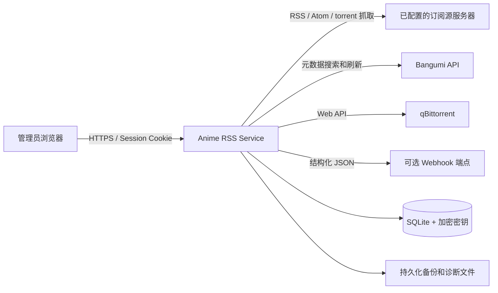
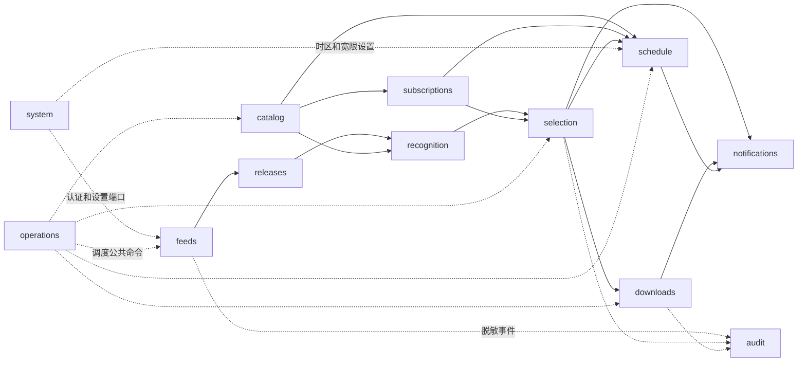
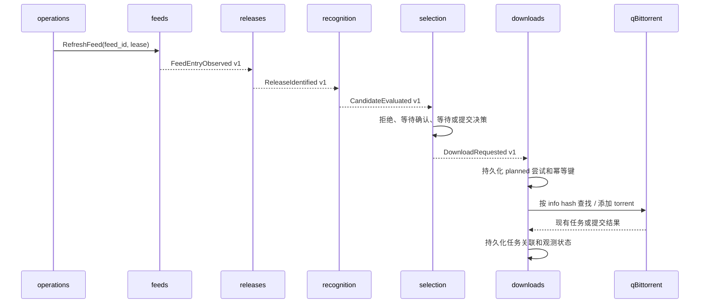
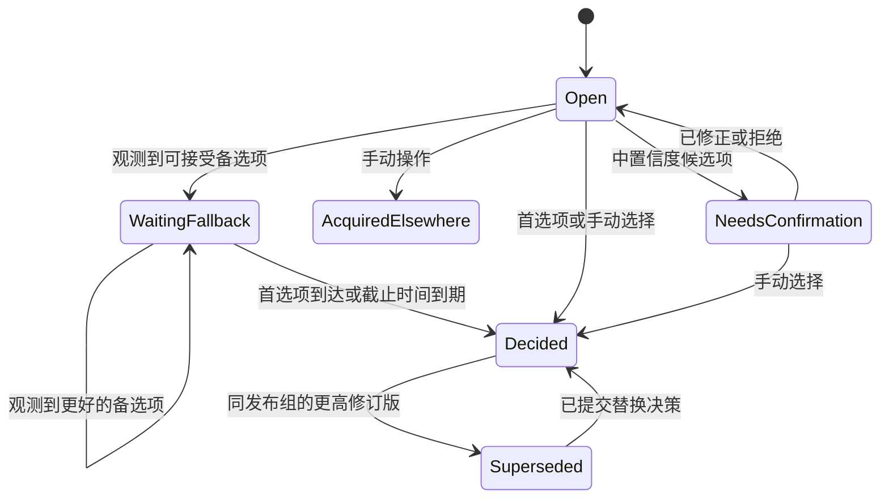

# Anime RSS Service 架构

状态：模块化单体基线已实现

日期：2026-07-21

来源：`DESIGN.md`

## 1. 架构目标

首个版本采用模块化单体：一个可部署容器、一个后端进程组、一个 React 应用和一个 SQLite 数据库。内部按产品能力划分，而不是按技术层划分。

这种形态是有意选择的。它让安装和运维适合单用户 NAS 服务，同时保留未来可拆分为独立包、工作器或服务的边界。

架构按以下顺序确定优先级：

1. 不产生重复或无法解释的下载提交。
2. 持久化决策、等待窗口、重试和下载器关联。
3. 确定性且可独立测试的解析和筛选决策。
4. 无需阅读整个仓库即可理解各模块。
5. 基于 SQLite 和 Docker Compose 的简单自托管运维。

本架构不会提前构建分布式系统，只采用支持未来拆分所必需的边界和投递语义。

## 2. 系统上下文



服务负责订阅、匹配理由、筛选历史，以及每个下载器任务背后不可变的本地意图。该意图要么来自筛选 Decision，要么来自运维人员显式提交的 Release；两种来源不可混用。qBittorrent 负责任务当前的运行时状态。Bangumi 和播出计划都不能直接触发下载。

## 3. 运行时拓扑

生产容器包含：

- FastAPI 应用，提供 `/api/v1`、健康端点和构建后的 React 资源；
- 同一进程组中的持久化调度循环；
- 一个使用 WAL 模式的 SQLite 数据库；
- 持久化数据卷中的备份目录和有界诊断存储。

默认使用一个 Uvicorn 工作器。更多 HTTP 工作器无法改善这种单用户工作负载，反而会增加 SQLite 写竞争。尽管如此，正确性仍必须通过数据库租约和比较并交换状态转换，容忍重启期间新旧进程的短暂重叠。

所有网络调用都在数据库写事务之外进行。工作器先在短事务中领取工作，执行外部调用，再在另一个短事务中记录结果。SQLite 配置必须启用 busy timeout、外键；挂载文件系统能够安全支持时还要启用 WAL。启动时必须先完成迁移，之后才接受 HTTP 流量或调度工作。

恢复应用、迁移检查、迁移前备份和 Alembic 升级都在 SQLite 数据库旁边的同一咨询文件锁内运行。进程退出时，操作系统会释放该锁。已有版本的数据库若有待执行迁移，必须先创建一份包含当前主密钥的在线 SQLite 快照；备份失败则中止迁移。全新安装和已处于当前 schema 的数据库跳过该备份。

## 4. 架构风格

### 4.1 按能力组织包

每个后端模块包含自己的领域模型、用例、持久化适配器、适用时的 HTTP 路由和测试。仓库中不存在全局 `models`、`services` 或 `repositories` 目录，避免读者为了理解一项能力而在整个目录树中来回跳转。

每个模块通过 `api.py` 暴露一小组公共接口，并在自己的 `README.md` 中记录。模块外部代码不得导入其 ORM 映射、仓库实现或内部领域对象。

### 4.2 模块内使用端口与适配器

业务规则使用纯 Python，不依赖 FastAPI、SQLAlchemy、qBittorrent、feedparser 或 HTTP 客户端。应用用例依赖端口，适配器实现这些端口。

并非每个模块一开始都需要四层目录。小型模块可以使用 `domain.py`、`application.py` 和 `adapters.py`；只有当文件无法作为整体轻松阅读时，才将它们改为子包。

### 4.3 命令、查询与事件

- **命令**请求一个模块修改状态，并返回一个小型结果 DTO。
- **查询**读取模块自有 DTO，绝不暴露 ORM 实体。
- **领域事件**是在本地事务期间使用的内部事实。
- **集成事件**是已持久化、带版本，并至少一次投递给另一模块的事实。
- **审计事件**是面向管理员的操作解释，不作为消息总线。

调用方需要立即获得结果时，适合直接调用 Python。异步工作流和未来拆分适合使用持久化集成事件。事件处理器必须幂等。

## 5. 后端模块

| 模块 | 负责的数据 | 公共职责 | 不得负责 |
| --- | --- | --- | --- |
| `system` | 管理员、Session、安装状态、时区、密钥引用 | 设置进度、登录/退出、Session 验证、设置、密钥加密 | 订阅源或下载器行为 |
| `feeds` | 订阅源配置、抓取状态、订阅源条目、抓取尝试 | 安全抓取、RSS/Atom 标准化、缓存验证器、重试健康状态 | torrent 标识或标题解释 |
| `releases` | 发布资源、来源观测、torrent 元数据和载荷引用 | magnet 标准化、torrent 验证、info-hash 标识、分层去重 | 动画匹配或筛选决策 |
| `catalog` | 动画、外部 ID、标题、别名、元数据和播出快照 | Bangumi 搜索/缓存、本地动画创建、用户元数据和播出覆盖项 | 自动下载决策 |
| `recognition` | 标题解析结果、匹配尝试、候选项、置信度、修正 | 确定性解析、动画/集数匹配、解释 | 偏好或下载器任务 |
| `subscriptions` | 订阅、规则配置、激活截止时间、生命周期 | 与订阅关联的有效规则和别名 | 候选项排序或播出计划状态 |
| `selection` | 等待状态、决策、手动覆盖、拒绝、升级计划 | 硬性过滤、字典序比较、备选计时器、历史补全预览、V2/V3 策略 | 外部下载器调用 |
| `schedule` | 预期集数、单集覆盖项、日历状态、缺集通知标记 | 每周基线和覆盖项投影、时区日历、分集历史、缺集状态评估 | 候选项、决策或下载请求 |
| `downloads` | qBittorrent 配置、提交尝试、幂等键、任务关联、观测状态 | 默认路径/分类/标签、提交/取消/重试/对账同步 | 决定哪个发布资源胜出 |
| `notifications` | 通知意图、投递尝试、应用内通知 | 触发通知的策略、JSON Webhook 投递和重试 | 产生通知的原始业务决策 |
| `audit` | 面向管理员的仅追加事件 | 可搜索历史和脱敏诊断上下文 | 工作流协调 |
| `operations` | 调度作业、租约、备份、保留作业、健康快照 | 持久化调度、备份/恢复、清理、就绪状态汇总 | 产品领域状态 |

### 5.1 重要所有权规则

- 即使没有可用 torrent 标识，`feeds` 仍会创建订阅源条目。`releases` 随后将一个或多个观测解析为唯一发布资源。
- `recognition` 负责证明某个发布资源对应某部动画的某一集。`selection` 使用这些证据，但绝不重新解析标题。
- `subscriptions` 负责规则配置；`selection` 为每个产生后果的决策存储当时有效规则的不可变快照。
- 在 `downloads` 联系 qBittorrent 前，`selection` 先提交自动下载请求。`downloads` 也可以负责显式的手动 Release 请求，但绝不会为此伪造 Candidate 或 Decision。下载器结果无法改写任一来源。
- `downloads` 镜像外部任务状态。外部删除会更新任务状态，但不能重新打开或清除原始决策。
- `audit` 接收来自各模块的脱敏事实。业务模块绝不查询审计记录来作出决策。
- `schedule` 可以从目录、订阅和筛选模块的公共事实推导缺集警告，但该警告只能进入 UI 和通知投影；它不能作为虚假候选项进入筛选状态机，也不能发出下载请求。

## 6. 依赖方向



箭头表示使用公共契约，而不是访问另一模块的数据表。禁止循环依赖。尤其是，下载器状态绝不能成为标题匹配的输入，通知投递也绝不能控制业务状态转换。

共享代码仅限于一个小型 `kernel` 包，其中包含稳定的技术类型，例如 UTC 时间辅助函数、类型化 ID、分页、结果/错误 envelope、关联 ID 和事件 envelope。`Episode`、`Candidate` 或 `Decision` 等领域概念不属于 `kernel`。

## 7. 主要持久化工作流



每一条异步跨模块箭头都由发送方事务中的 outbox 记录支持。分发器至少投递一次，并在 inbox 表中记录消费者进度。因此，重复投递会产生同样的结果，而不会生成重复记录或 qBittorrent 请求。

建议的初始事件契约包括：

- `FeedEntryObserved.v1`
- `ReleaseIdentified.v1`
- `CandidateEvaluated.v1`
- `DecisionWaitingStarted.v1`
- `DecisionCommitted.v1`
- `DownloadRequested.v1`
- `DownloadTaskChanged.v1`
- `ManualConfirmationRequired.v1`

事件载荷携带 ID、时间戳和稳定事实，而不是序列化的 ORM 或完整聚合对象。契约版本必须明确，以便未来拆出的工作器能够独立升级。

## 8. 决策与分集状态

集数标识使用值对象，而不是浮点数：

```text
EpisodeKey = Single(Decimal) | Range(Decimal, Decimal)
```

`7.5`、`1-2` 等规范字符串与结构化数值边界一同存储。禁止使用浮点存储。

对于一个订阅和一集，`selection` 维护一套串行化自动化状态机：



状态记录的版本单调递增。命令使用 `WHERE version = expected_version` 更新；竞争失败的一方重新加载并评估。这样可避免计时器到期与新首选候选项同时到达时产生重复决策。

第一个可接受备选项会固定等待截止时间。后续候选项可以替换当前最佳备选项，但不会延长窗口。每次比较都会持久化：

- 解析属性和匹配置信度；
- 硬性过滤结果；
- 当时有效的有序偏好快照；
- 决定排序结果的第一个字段；
- 激活截止时间和候选项首次观测时间；
- 自动、历史补全、重试或手动触发来源；
- 关联 ID 和因果 ID。

决策记录面向追加。重置会创建新的状态转换或决策，绝不会改写历史来伪装旧决策从未发生。

## 9. 幂等性与外部副作用

对于无法与本地数据库共同提供事务的 API，本服务实现实际上的单次提交。

1. `selection` 在同一事务中创建已提交决策和唯一自动下载请求；或者由 `downloads` 记录显式的手动 Release 请求，而不创建筛选历史。
2. `downloads` 在发出网络请求前，记录带持久化幂等键的 `planned` 提交尝试。
3. 每次添加或重试前，都按 info hash 查询 qBittorrent。
4. 如果上一次调用成功但响应丢失，对账同步会关联现有 torrent，而不是再次添加。
5. 唯一数据库约束确保同一决策或手动 Release 意图只有一个请求；手动命令还会复用已关联到该 Release 的任何任务。
6. 已观测任务必须经过连续两次成功的空查询才会变为 `externally_removed`；任务存在或查询失败都会重置确认。除非管理员明确要求，否则禁用自动重试。

幂等键由不可变 ID 派生，例如 `download-request:{decision_id}:{release_id}:{operation_revision}` 或 `manual-release:{release_id}:{operation_revision}`。info hash 仍是最终的跨订阅源发布资源标识。

修订版替换是由 `selection` 负责的显式 saga：

- 提交升级决策；
- 旧任务未完成时请求取消；
- 记录取消观测；
- 请求提交新任务；
- 将旧任务/发布资源标记为已被取代，但不删除已完成文件。

每一步都可重试且可见。部分失败会保留为可处理状态，而不是被回滚或隐藏。

## 10. 持久化架构

首个版本的所有模块共享一个物理数据库，但每张表只有一个所有者，并带模块前缀：

```text
sys_*        feed_*       release_*     catalog_*
match_*      sub_*        select_*      download_*
notify_*     audit_*      runtime_*
```

持久化边界规则：

- 只有所属模块可以写自己的表；
- 其他模块将外部 ID 存为类型化标量，并通过查询获取当前数据；
- ORM 关系不得跨模块边界；
- 跨模块外键可以在单体中保证完整性，但业务代码不得依赖关系导航；
- 跨模块 join 只允许用于可丢弃的读投影；
- 迁移按模块分组，但通过同一条 Alembic 历史排序；
- 原始外部载荷必须有界，必要时脱敏，且默认不加载到领域对象中。

写模型为正确性而标准化。仪表盘和详情页面使用由集成事件构建的反规范化 `read_*` 投影。投影可以重建，不拥有业务事实。这样既能防止 UI 查询需求侵蚀模块边界，也能让未来服务拆分成为 API 组合变化，而不是重写领域。

### 10.1 持久化作业

`operations` 负责通用持久化作业表，其中包含作业类型、去重键、载荷版本、下次运行时间、尝试次数、租约所有者、租约到期时间和最近错误类别。唯一 `(job_kind, deduplication_key)` 约束阻止重复周期性工作。

业务截止时间仍属于业务数据。例如，备选截止时间由 `selection` 负责；调度器只负责找到它并调用 `ExpireFallbackWindow`。因此，调度器队列丢失或重建不会丢失实际等待状态。

### 10.2 事务规则

- 一个命令在一个短事务中只修改一个模块；
- 同一事务持久化其 outbox 和审计意图；
- 网络调用、超长输入解析和 Webhook 投递位于写事务之外；
- 消费者在状态变更的同一事务中确认 inbox 消息；
- 时间戳使用 UTC，测试中通过时钟端口提供。

## 11. 外部适配器契约

外部系统位于窄接口之后：

```python
class MetadataProvider(Protocol): ...
class FeedHttpClient(Protocol): ...
class TorrentResolver(Protocol): ...
class Downloader(Protocol): ...
class NotificationChannel(Protocol): ...
class SecretCipher(Protocol): ...
class Clock(Protocol): ...
```

qBittorrent 适配器是首个版本唯一的 `Downloader` 实现，但契约使用产品术语：连通性检查、按 info hash 查询、提交、观测，以及取消未完成任务。qBittorrent 原始响应对象不会暴露到 `downloads` 之外。

标题解析器是纯识别器，不是适配器。给定相同的标准化标题和解析规则版本，必须返回逐字节等价的结构化输出。夹具语料库是模块契约的一部分。

## 12. HTTP API 与认证

每个功能模块注册自己的 `/api/v1` 路由。HTTP 处理器只负责：

1. 认证并验证传输层数据；
2. 构造命令或查询；
3. 调用模块公共应用 API；
4. 将类型化结果映射为稳定 HTTP 错误。

处理器不包含筛选、解析或重试逻辑。OpenAPI schema 是传输 DTO，与领域类型分离。前端类型和客户端函数在 CI 中根据受检 OpenAPI 契约生成。

`system` 模块使用带随机不透明 Cookie 的服务端 Session。只存储 Session token 的哈希。修改状态的请求必须经过源检查和 CSRF 保护。Cookie 设置为 `HttpOnly`、`SameSite=Lax`，通过 HTTPS 提供时还设置 `Secure`。密码哈希使用内存困难算法。

凭据通过 `SecretCipher` 进行 envelope 加密；明文绝不存入普通设置或日志。主密钥与数据库分开提供，最好使用挂载的密钥文件。可读配置导出只包含密钥引用，凭据导出使用单独的加密格式。

## 13. 抓取与输入安全

HTTP 抓取是共享的底层适配器，策略由相应模块提供。即使使用同一 HTTP 库，订阅源策略和 torrent 策略也相互独立。

- 只有管理员显式配置后才抓取订阅源 URL；
- 重定向次数、连接/读取超时和响应大小均有上限；
- 跨主机重定向时移除凭据和自定义请求头；
- 解析前验证订阅源内容类型和 XML 大小；
- torrent 下载只接受 HTTP(S)，采用更小且严格的大小限制，并且必须包含有效的 bencode info 字典才可建立标识或提交；
- 日志、事件载荷、关联上下文和 UI 诊断使用中央脱敏器处理 URL token、请求头、Cookie 和已知密钥；
- HTML 描述视为不可信文本，绝不触发二次抓取。

## 14. 前端架构

React 应用映射后端能力，而不是将所有组件、Hook 和 Store 全局分组：

```text
web/src/
  app/                  # 路由、认证外壳、Provider
  features/
    setup/
    dashboard/
    feeds/
    anime/
    subscriptions/
    schedule/
    confirmation/
    releases/
    downloads/
    notifications/
    audit/
    operations/
  generated/api/        # 生成的 OpenAPI 类型和客户端
  shared/                # 设计基础组件、格式化，不含领域行为
```

每个功能负责自己的路由、服务端状态查询、表单、组件和测试。功能之间不得导入彼此的内部实现。共享页面使用 `app` 中的小型组合层和后端读投影。服务端状态保留在查询缓存中，临时表单和展示状态保留在本地。全局客户端 Store 不得复制订阅、决策或任务事实。

设置功能是应用级协调器：它调用各能力负责的公共 HTTP 操作，然后记录幂等的系统步骤。它不会导入其他功能的表单，也不会复制后端领域决策。

识别修正通过候选项取代实现。旧候选项和所有决策快照保持不可变；带版本事件允许筛选模块只重新打开未决时段，并为已决时段追加修正证据。

## 15. 建议的仓库布局

```text
anime-rss-service/
  DESIGN.md
  ARCHITECTURE.md
  README.md
  pyproject.toml
  uv.lock
  Makefile
  backend/
    src/anime_rss/
      main.py                   # 应用工厂和组合根
      config.py
      kernel/
      modules/
        system/
        feeds/
        releases/
        catalog/
        recognition/
        subscriptions/
        selection/
        downloads/
        notifications/
        audit/
        operations/
      infrastructure/
        database.py             # 共享引擎/Session 机制
        event_dispatcher.py
        logging.py
    tests/
      architecture/             # 禁止导入和契约检查
      integration/
      security/
      unit/
  web/
    package.json
    src/
      app/
      features/
      generated/api/
      shared/
  migrations/
    versions/
  parser-fixtures/
  deploy/
    compose.yaml
  docs/
    adr/
    contracts/
```

每个后端模块从以下易读结构开始：

```text
modules/<name>/
  README.md          # 目的、自有数据、公共命令/查询/事件
  api.py             # 其他模块唯一受支持的导入入口
  domain.py          # 实体、值对象、状态转换
  application.py     # 命令、查询、编排、端口
  persistence.py     # SQLAlchemy 映射和仓库
  http.py            # 可选 FastAPI 路由
  adapters.py        # 可选外部适配器
```

当某个文件过大时，只将该文件替换为同名子包。这样既保持早期实现易读，也不会在功能增长时放弃边界。

## 16. 测试策略

测试应对应风险和模块边界。

### 纯领域测试

- 解析器夹具语料库，覆盖发布组、语言、格式、错误和超长输入；
- 硬性过滤和字典序偏好表格测试；
- 集数键和修订版规则；
- 生命周期及等待状态转换测试；
- 确定性解释快照。

### 模块集成测试

- 仓库约束和乐观并发控制；
- outbox/inbox 重复投递；
- 订阅源标准化和发布资源去重；
- 订阅激活及暂停截止时间；
- 所有持久化状态的备份和恢复。

### 适配器契约测试

- 订阅源 HTTP 重定向和凭据行为；
- Bangumi 中断和缓存回退；
- qBittorrent 提交、成功后超时、对账同步、外部暂停、外部删除及路径/标签修改；
- Webhook 重试和密钥脱敏。

### 端到端验收测试

使用一次性 SQLite 和伪外部服务器验证 `DESIGN.md` 中的 12 项验收标准。在最容易暴露状态丢失的位置增加重启测试：备选等待窗口期间、提交已规划但响应尚未到达时，以及修订版替换期间。

架构测试应拒绝导入其他模块的 `domain`、`persistence` 或 `adapters`，并拒绝跨模块包的 ORM 关系。这样可以让文档中的边界成为可执行约束。

## 17. 可观测性

每次操作获得一个关联 ID；派生的命令和事件还携带因果 ID。结构化日志包含模块、操作、实体 ID、尝试次数、耗时和结果，但绝不包含原始密钥或完整私有 URL。HTTP 中间件、持久化调度器和集成事件分发是三类上下文边界；业务服务继承上下文，而不是接收传输层特有的日志参数。

保留策略与写入遵循相同的所有权规则。`operations` 调度并汇总一次运行；`feeds`、`releases`、`recognition`、`selection` 和事件存储则为自有记录暴露公共保留查询或命令。

健康状态分为：

- **存活状态**：进程事件循环能够响应；
- **就绪状态**：迁移已完成且数据库可写；
- **依赖状态**：向管理员展示订阅源、Bangumi、qBittorrent、调度器和 Webhook 健康状态，但不让进程就绪状态依赖可选外部系统。

探针端点禁用访问日志。调度器和 outbox 延迟、未过期租约、等待中的筛选决策、过期下载器观测和失败尝试均可通过运维视图查询。

## 18. 拆分策略

满足以下条件时，模块才适合成为独立进程或服务：

1. 所有调用方只使用其 `api.py` DTO 和带版本事件；
2. 只有该模块写自己的表；
3. 事件处理器幂等；
4. 读取需求由查询或投影表示；
5. 集成契约有契约测试；
6. 运维收益值得增加一个部署和故障边界。

如果未来规模或独立维护需要拆分，可能的顺序为：

1. Webhook 投递工作器；
2. 订阅源抓取和发布资源获取工作器；
3. Bangumi 元数据刷新工作器；
4. qBittorrent 对账同步工作器。

`subscriptions`、`recognition` 和 `selection` 应最长时间保持在一起。它们围绕低流量、事务敏感的决策密切协作，网络隔离几乎没有收益。拆分只是选项，不是首个版本目标。

## 19. 交付切片

实现应在遵循 `DESIGN.md` 阶段顺序的同时，产出纵向、可审核的切片：

1. **获取切片：** `system` 密钥支持、`operations` 作业租约、`feeds`、`releases` 及其审计/读视图。
2. **识别切片：** `catalog`、纯解析器、候选项匹配、修正夹具和解释。
3. **决策切片：** `subscriptions`、分集状态、筛选策略、等待截止时间、历史补全预览和升级 saga。
4. **下载切片：** 下载器端口、qBittorrent 适配器、提交幂等性、对账同步和失败恢复。
5. **产品切片：** 设置/认证、仪表盘投影、异常工作流和响应式功能页面。
6. **播出计划切片：** 参考性播出元数据、预期集数、日历、缺集警告和时区展示。
7. **运维切片：** 通知、备份、保留、诊断、容器镜像、逐架构冒烟/安全门禁、Compose 和浸泡测试。

每个切片都包括迁移、模块 README 契约、领域测试、适配器测试、OpenAPI 变更、生成的前端客户端，以及验证流程所需的最小 UI。只引入数据库表或框架脚手架而没有贯通系统的可运行路径，不能视为阶段完成。

发布工具位于能力模块之外的 `scripts/` 中。它可以调用公共 CLI 和 Makefile 接口、创建分离 worktree 并收集证据，但不得导入模块持久化模型，也不得成为另一套业务工作流。运行时诊断属于 `system` 且保持只读；验收投影只读消费持久化公共证据。

## 20. 架构决策

开始实现后，应将以下决策保留为 ADR：

- 先采用模块化单体，再考虑服务拆分；
- 首个版本使用一个 Uvicorn 工作器和 SQLite WAL；
- 表由模块负责，不进行跨模块 ORM 导航；
- 异步跨模块工作使用持久化 outbox/inbox；
- 业务截止时间存于数据库，调度器使用通用租约；
- 使用确定性解析器和字典序筛选，运行时不使用 LLM；
- 决策和审计历史面向追加；
- 通过 qBittorrent 对账同步实现实际上的单次外部副作用；
- 前端按功能切片，并使用生成的 OpenAPI 客户端。

任何削弱解释历史、持久化状态或幂等性的未来变更都必须经过明确的架构审核。这些是产品正确性属性，不是可选实现细节。
