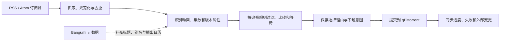

# Anime RSS Service

Anime RSS Service 是一个面向单用户的自托管追番下载服务。它持续读取你订阅的 RSS/Atom，识别其中的动画、集数、字幕组、分辨率和编码，根据你的偏好挑出合适版本，并把最终结果提交给 qBittorrent。

它解决的不是“如何订阅一个 RSS”，而是 RSS 之后那段容易出错的工作：同一集可能同时出现在多个订阅源里，也可能先来一个能看的版本，稍后才出现你真正想要的字幕组。服务会把这些发布资源归到同一集下，过滤不接受的版本，必要时等待更好的候选，最后只创建一次可解释、可追踪的下载。

## 它是怎样工作的

假设某部动画的第 7 集先出现了一个 720p 的可接受版本，而你的首选是某字幕组发布的 1080p HEVC。Anime RSS Service 不会简单下载最先出现的条目。它会为这个备选版本开启等待窗口；如果首选版本及时出现，就立即选择首选，否则在窗口结束后下载当前最好的可接受版本。这个等待状态会持久化，服务重启也不会丢失。

一次自动下载始终从 RSS 中实际出现的发布资源开始。Bangumi 只负责补充动画身份、别名和播出日历，不会因为“今天应该更新”就凭空创建下载任务。最终选择、等待过程、手动覆盖和 qBittorrent 提交结果都会留下记录，因此你可以回头看到某个版本为什么被接受、拒绝或取代。

## 你可以用它做什么

### 把多个订阅源整理成一个发布资源库

你可以添加多个 RSS 或 Atom 地址，并查看每个来源的抓取状态、重试情况和历史记录。来自不同订阅源的同一个 torrent 会按 BitTorrent info hash 合并，不会因为标题或来源不同而重复下载。订阅地址、自定义请求头、magnet 链接和 torrent 载荷会加密保存在本地数据库中。

### 为每部动画定义清晰的选择规则

动画可以从 Bangumi 搜索导入，也可以完全在本地创建。创建追番后，可以设置拒绝 RAW、4K、特定字幕语言、合集或字幕组等硬性条件，再按字幕组、字幕语言、分辨率、编码、修订版和发布时间排列偏好。

偏好是有顺序的明确比较，不是无法解释的综合评分。候选页面会展示标题解析结果、匹配置信度、拒绝原因，以及一个版本在哪个偏好字段上输给另一个版本。识别结果有歧义时，自动化会停下来等待确认，而不是猜测后继续下载。

### 自动下载，也允许人工接管

满足全部首选条件的发布资源会立即进入下载流程；可接受的备选版本则按照订阅设置等待。对于旧番或刚建立的订阅，可以先预览历史补全会选择哪些版本，再确认提交。剧场版、OVA、特别篇和季度合集不会自动选择，但仍会保留在发布资源库中供手动提交。

同字幕组发布 V2、V3 修订版时，服务可以替换尚未完成的旧任务；已经完成的文件不会被自动删除。你也可以手动确认中等置信度候选、修正未匹配条目、替换单集选择、标记已从其他渠道获取，或显式重试失败任务。

### 在首页决定这一季追什么

首页会从 Bangumi 整理本季 TV 和 WEB 新番。你可以按季度浏览，标记正在追、已看完或不追；追番会创建或恢复对应订阅，已看完和不追则会归档已有订阅。列表中的追番状态直接来自订阅，“已看完”和“不追”作为明确决定单独保存。

首页也汇总订阅源健康、近期发布、播出日历和缺集提醒。下载页面以 qBittorrent 的实际状态为准，对账同步排队、下载、完成、失败和外部删除；系统页面集中显示调度器、外部依赖和需要人工处理的异常。

应用内通知会提示需要确认或处理的事件，也可以把结构化 JSON 通知投递到 Webhook。审计历史只追加不改写，下载决策和下载器当前状态彼此独立，所以外部删除一个任务不会抹掉当时为什么下载它。

## 适用边界

| 适合 | 不属于本项目 |
| --- | --- |
| 单一管理员在 NAS 或 Linux 设备上自托管 | 多用户、共享订阅和公共托管 |
| 自动追踪当季电视动画的单集发布 | 媒体播放、转码、刮削和观看进度 |
| qBittorrent 4.6/5.x 下载任务提交与状态同步 | 替代 Jellyfin、Emby、Plex 或 qBittorrent |
| 整数集、小数集、集数范围和同组 V2/V3 | 自动选择剧场版、OVA、特别篇或整季合集 |

应用按单管理员、单进程设计。自动化的边界止于下载任务已提交、持续对账并确认完成；媒体库后续处理交给现有媒体系统。

## 部署与开发

安装、升级、备份恢复、反向代理和本地开发说明见[部署与开发文档](docs/deployment.md)。
